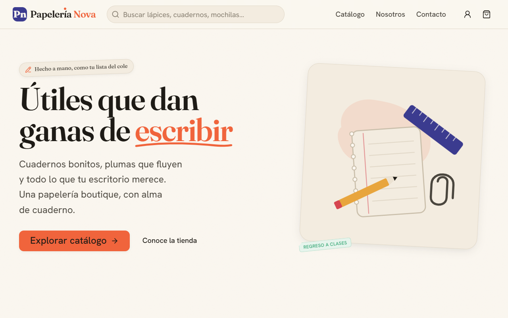
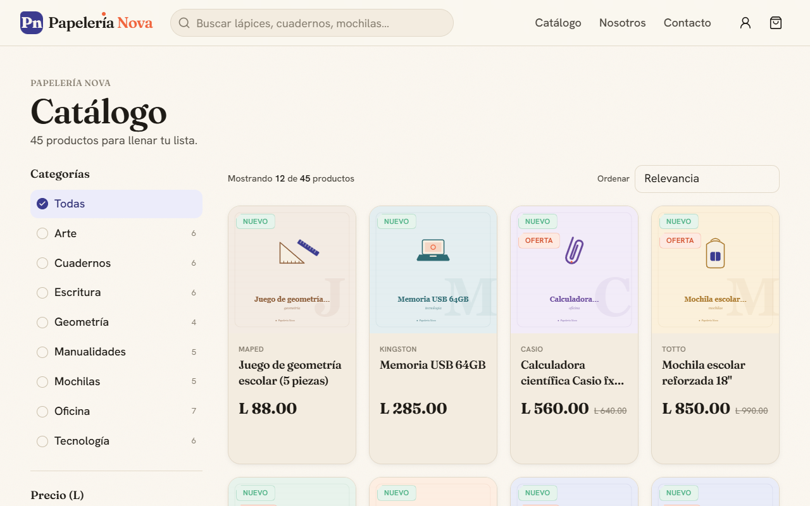
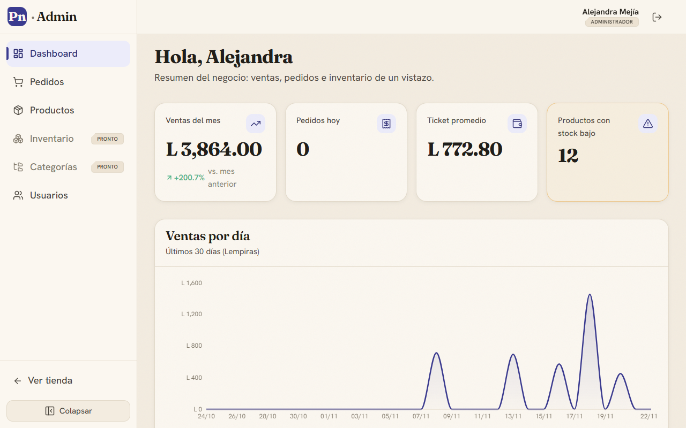
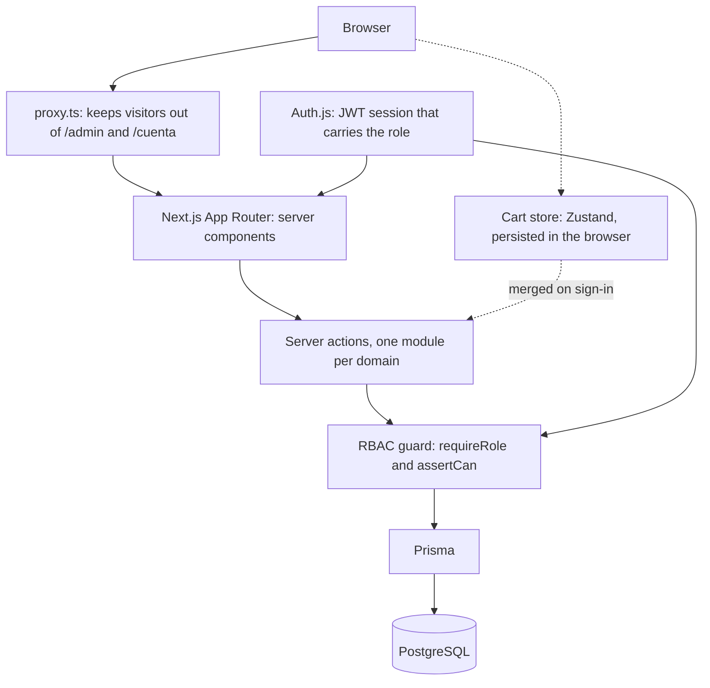

# Papelería Nova

An online store for school and office supplies, built end to end: a catalog with search and filters, a cart that survives reloads, checkout, customer accounts and an admin area with dashboards. The brand is fictional and the store targets Honduras, so the interface is in Spanish and prices are in Lempiras.

It exists to show a complete e-commerce flow that does not look like a template: its own design system, its own UI primitives, and authorization enforced on the server.



| Catalog | Admin dashboard |
| --- | --- |
|  |  |

## Features

- **Catalog** with search, sorting and filters kept in the URL (category, price, brand, stock), and a page per product.
- **Cart** in a drawer, persisted in the browser and merged into the account's cart on sign-in.
- **Checkout** that creates the order atomically. Payment is simulated.
- **Four roles**: `admin`, `vendedor` (seller), `cliente` (customer) and `invitado` (guest), each with its own permissions.
- **Admin area**: a dashboard with KPIs and charts, product management, order management with restocking, and user management that cannot lock the last administrator out.
- **Account area**: orders with their detail, profile with password change, and addresses.
- **Informative pages with SEO**: JSON-LD, sitemap, robots and manifest.

## Stack

Next.js 16 (App Router) · TypeScript (strict) · Tailwind CSS v4 with its own tokens · PostgreSQL and Prisma 6 · Auth.js (NextAuth v5) with JWT sessions that carry the role · Zustand · Zod 4 · Recharts · Framer Motion · lucide-react · Vitest

## Run it locally

Requirements: Node.js 20 or newer and PostgreSQL 14 or newer.

```bash
cp .env.example .env     # set DATABASE_URL and AUTH_SECRET (generate one with: npx auth secret)
npm install
npm run db:push          # create the schema
npm run db:seed          # categories, products, users and orders, all fictitious
npm run dev              # http://localhost:3000
```

The seed creates these accounts. They are for development only:

| Role | Email | Password |
| --- | --- | --- |
| Admin | `admin@papelerianova.hn` | `Admin123!` |
| Seller | `vendedor@papelerianova.hn` | `Vendedor123!` |
| Customer | `cliente@papelerianova.hn` | `Cliente123!` |
| Customer | `cliente2@papelerianova.hn` | `Cliente123!` |

| Script | What it does |
| --- | --- |
| `npm run dev` | Development server. |
| `npm run build`, `npm run start` | Production build and server. |
| `npm run lint`, `npm run format` | ESLint and Prettier. |
| `npm run typecheck` | `tsc --noEmit`. |
| `npm test` | Unit tests with Vitest (555 tests). |
| `npm run db:push` | Syncs the schema with the database. |
| `npm run db:seed` | Seeds the test data. It can be run again safely. |
| `npm run db:studio` | Prisma Studio. |

## Architecture



- **Pages** are server components under `src/app`: the storefront in `(public)`, sign-in and sign-up in `(auth)`, the account area in `(cuenta)`, and `admin`.
- **Server actions** live in `src/server`, one module per domain: catalog, cart, orders, account, addresses, contact, and the admin modules for metrics, orders, products and users.
- **Data** is PostgreSQL through Prisma: users, categories, products with images, addresses, carts, orders with their items, reviews and contact messages.

## Technical decisions

- **Authorization always runs on the server.** Every sensitive server action calls `requireRole` or `assertCan` (`src/lib/auth/guard.ts`). `src/proxy.ts` only spares the visitor a page they cannot use.
- **Sessions are plain JWTs**, with no `Account` or `Session` tables. The schema has a note for adding them if OAuth is turned on, and the Google provider is already outlined in `src/lib/auth/config.ts`.
- **Server components read the session with `await auth()`**, so `SessionProvider` is not mounted. `src/components/providers.tsx` is ready for the day a client component needs `useSession()`.
- **Tailwind v4 without a `tailwind.config`.** The tokens live in `src/styles/tokens.css` and become utilities through `@theme inline` in `globals.css`.
- **Prisma stays on version 6.** Moving to Prisma 7 (`prisma.config.ts`, the new generator) is a deliberate follow-up.
- **The cart lives in the browser first.** A Zustand store persists it under the key `pn-cart`, and signing in merges it with the cart saved for the account.
- **Charts only draw.** The dashboard's numbers are computed on the server and reach the chart components as props.

## Status

Done: the catalog and product pages, the cart with its merge on sign-in, checkout with atomic orders and simulated payment, the admin area (dashboard, products, orders with restocking, users), the informative pages with SEO, and the account area.

Pending, in the order I would take them:

1. An inbox for contact messages in the admin area (messages are already stored).
2. Category management in the admin area (the permission already exists).
3. End-to-end tests with Playwright for the critical flows.
4. Rate limiting on sign-in, sign-up and the contact form.
5. Production details: a default Open Graph image, PWA icons, real texts for the legal pages, an audit log table, a dark mode switch (the tokens are ready) and the move to Prisma 7.

## Project structure

```
src/
  app/            (public) storefront · (auth) sign-in and sign-up · (cuenta) account · admin · api
  components/     ui (own primitives) · storefront · admin · layout
  lib/            prisma, auth (config and RBAC guards), utils
  stores/         zustand (the persistent cart, "pn-cart")
  server/         server actions by domain
  styles/         tokens.css and globals.css (the design system)
  proxy.ts        route protection for /admin and /cuenta (Next.js 16)
prisma/           schema.prisma and seed.ts
```

Identifiers, routes and interface texts are in Spanish, the language of the store's domain. Comments and documentation are in English.

## License

Copyright © 2026 Alejandro Vargas. All rights reserved. The code is published for reference: no permission is granted to copy, modify or distribute it. See [LICENSE](LICENSE).
